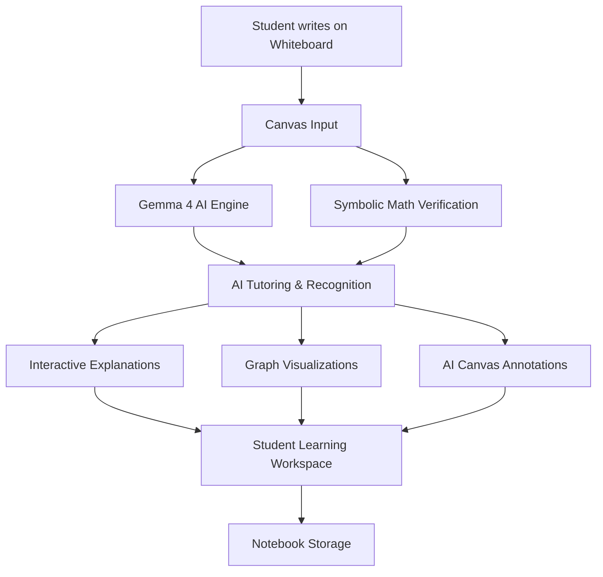

<div align="center">

# MYPREP

### Margin — Your AI-Powered Mathematics Notebook

**Write naturally. Understand deeply. Learn with Gemma 4.**

An intelligent digital whiteboard that understands handwritten mathematics, explains concepts, checks your work, and transforms equations into interactive visualizations.


[Features](#-key-features) • [Demo][#-video-demonstration](https://drive.google.com/file/d/17lGD0RVXklf0f8iCV-j_7Z_rZBBXDUx5/view?usp=sharing) • [Installation](#-installation) • [Architecture](#-system-architecture)

</div>

---

## 🌟 What is MYPREP?

**MYPREP (Margin)** is an AI-powered mathematical learning environment designed to make learning feel as natural as writing in a notebook.

Instead of typing mathematics into a traditional chatbot, students can write directly on an interactive whiteboard.

Powered by Google's Gemma 4 models, the application is designed to interpret mathematical expressions, generate contextual explanations, provide tutoring assistance, and visualize equations.

A dedicated symbolic verification layer built with SymPy helps validate mathematical operations.

### Our Vision

**What if your notebook could understand what you're thinking?**

MYPREP explores a learning experience where AI becomes a companion within the student's workspace instead of a separate chatbot.

---

## 📸 Application Preview


*The MYPREP workspace showing handwritten mathematical expressions, Gemma 4 tutoring, graph visualization, AI explanations, and conversational learning.*

---

## 🎬 Video Demonstration

### Watch MYPREP in Action

[▶ Watch the Full Demo Video](./media/demo.mp4)

[](./media/demo.mp4)

The demonstration showcases the AI-powered mathematics workspace and how students can interact with mathematical content directly on the canvas.

---

## 🚀 Key Features

### ✍️ 1. Intelligent Digital Whiteboard

A freeform canvas for solving mathematics naturally.

- Handwritten mathematical expressions
- Multiple pen colors and drawing tools
- Eraser and selection controls
- Zooming and panning
- Grid-based notebook backgrounds
- Movable AI-generated elements

### 🧠 2. Gemma 4 AI Mathematics Tutor

Integrated AI tutoring built around Gemma 4.

- Contextual mathematical explanations
- Guided problem-solving
- Hints and suggestions
- Step-by-step learning assistance
- Handwriting interpretation
- Conversational tutoring

### 🤖 3. Six-Agent AI System

MYPREP includes six specialized AI agent roles.

| Agent | Purpose |
|---|---|
| Problem Overseer | Understands the problem context |
| Problem Analyzer | Analyzes mathematical expressions |
| Whiteboard Co-Writer | Assists with writing on the canvas |
| Socratic Explainer | Provides educational explanations |
| Artifact Generator | Generates supporting learning objects |
| Handwriting Beautifier | Helps transform rough mathematical writing |

### 📈 4. Interactive Mathematical Graphing

Visualize mathematical functions directly within the notebook.

- Function plotting
- Coordinate visualization
- Interactive graph cards
- Mathematical expression rendering
- Graphs alongside handwritten solutions

### ✅ 5. Mathematical Verification

MYPREP combines AI assistance with deterministic mathematical tools.

- SymPy mathematical verification
- Derivative calculations
- Integration support
- Equation solving
- Algebraic step checking
- Domain restriction checks

AI-generated explanations and mathematical verification are handled separately.

### 🎙️ 6. Conversational Voice Tutor

An interactive tutoring interface that supports voice-based learning controls.

Students can interact with the tutor while working through mathematical problems.

### 📄 7. Worksheet Support

Work with mathematical worksheets inside the same workspace.

- Worksheet import interface
- Annotation tools
- Problem-specific AI assistance
- Handwritten notes alongside questions

### 📓 8. Notebook Management

Organize mathematical work into persistent notebooks.

- Multiple notebooks
- Notebook pages
- Stored canvas content
- SQLite-backed persistence
- Prisma database integration

---

## 🏗️ System Architecture



---

## 🛠️ Technology Stack

| Category | Technology |
|---|---|
| Frontend | Next.js 14, React 18 |
| Language | TypeScript |
| Styling | Tailwind CSS |
| AI Model | Gemma 4 |
| AI Integration | Google GenAI SDK, Ollama |
| Mathematics | SymPy, Math.js |
| Math Rendering | KaTeX |
| Backend APIs | Next.js API Routes |
| Verification Service | Python, FastAPI |
| Database | SQLite |
| ORM | Prisma |
| Validation | Zod |

---

## 💻 Installation

### Requirements

- Node.js 18 or newer
- Python 3.11 or 3.12
- npm
- Optional: Ollama for local AI inference
- Optional: Google AI API key for hosted inference

### Step 1: Clone the Repository

```powershell
git clone https://github.com/lochanharishwar/MYPREP.git
cd MYPREP
```

### Step 2: Install Dependencies

```powershell
npm install
python -m pip install -r services/math/requirements.txt
```

### Step 3: Configure Environment Variables

```powershell
Copy-Item .env.example .env
```

For hosted Gemma 4 inference, configure `.env`:

```env
GEMMA_BACKEND=google-gemma-api
GEMMA_GOOGLE_MODEL=gemma-4-26b-a4b-it
GEMINI_API_KEY=your_api_key_here
DATABASE_URL=file:./dev.db
```

Alternatively, use the Ollama backend with an installed compatible model, or set `GEMMA_BACKEND=mock` for development without live inference.

**Never upload your actual `.env` file or API keys to GitHub.**

### Step 4: Initialize Database

```powershell
npx prisma db push
```

### Step 5: Run the Application

```powershell
npm run dev
```

Open:

**http://localhost:3000**

### Step 6: Start SymPy Verification Service

Open a second terminal:

```powershell
python services/math/main.py
```

The optional mathematical verification service runs at:

`http://127.0.0.1:8001`

### Step 7: Run Diagnostics

```powershell
npm run doctor
npm run test:math
```

---

## 🧪 Example Learning Scenarios

**Scenario 1 — Differentiation**

Write `f(x) = 6x²` and request an explanation of its derivative.

**Scenario 2 — Error Detection**

Write an incorrect equation such as `d/dx(x³) = 2x²` and request a step check.

**Scenario 3 — Interactive Graphing**

Plot `y = x² - 4x + 3` and explore its mathematical behavior.

**Scenario 4 — Worksheet Learning**

Import a worksheet, annotate the question, and request guidance.

**Scenario 5 — Conversational Tutoring**

Interact with the tutoring interface using supported voice features.

---

## 📁 Project Structure

```text
MYPREP/
├── app/
│   ├── api/
│   │   └── ai/
│   └── notebook/
├── components/
│   ├── agents/
│   ├── ai/
│   ├── canvas/
│   ├── graph/
│   ├── math/
│   ├── pdf/
│   └── voice/
├── lib/
│   ├── ai/
│   ├── canvas/
│   ├── math/
│   └── types/
├── prisma/
├── services/
│   └── math/
├── scripts/
├── media/
│   ├── demo.mp4
│   └── images/
│       └── workspace.png
├── .env.example
├── package.json
└── README.md
```

---

## 🧭 Project Status

MYPREP is an active development project.

Some features depend on configured AI services, compatible models, browser permissions, and available hardware.

Generative AI responses should be checked before being treated as mathematically correct.

---

## 👨‍💻 Developed By

**[lochanharishwar](https://github.com/lochanharishwar)**

GitHub Repository: [MYPREP](https://github.com/lochanharishwar/MYPREP)

---

<div align="center">

### MYPREP

**Your Mathematics. Your Whiteboard. Your AI Tutor.**

Built with Gemma 4, Next.js, and SymPy.

</div>
